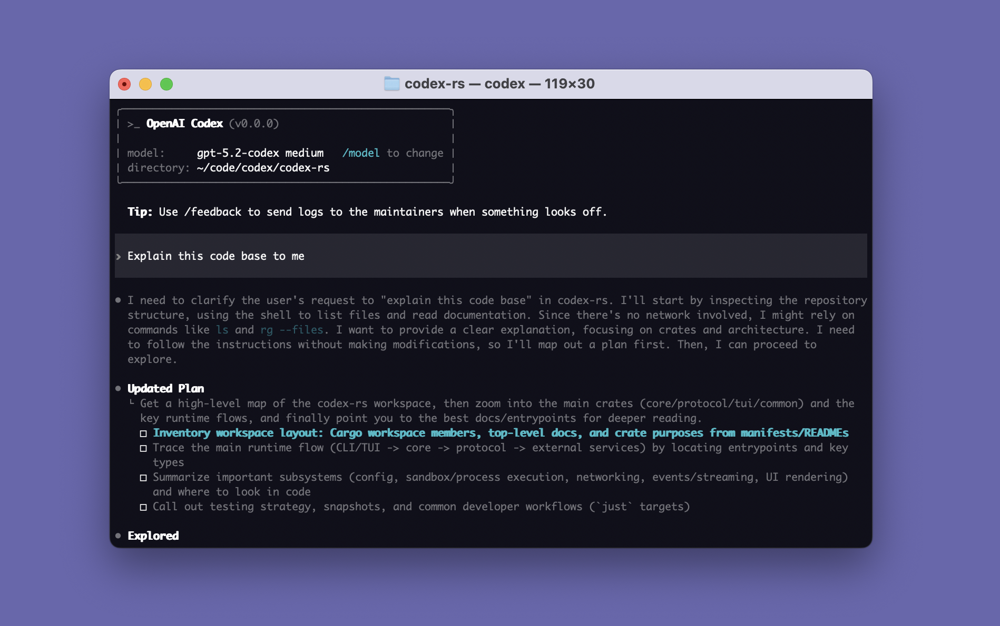

> **Dex fork notice:** This branch applies a literal name replacement across the source tree. Renamed package names, model IDs, release URLs, and service endpoints are not created or registered by this change. Configure real endpoints and published packages before using the hosted installation commands or connecting to remote services. The existing splash screenshot has not been re-rendered.

> **Privacy:** Dex has no product-analytics delivery, Statsig/OTLP network exporters, or feedback/diagnostic uploads. Legacy analytics, feedback, and exporter settings cannot re-enable those functions. Local diagnostic logs and in-memory metrics remain available. Model-provider requests, MCP connections, plugin downloads, authentication, and update checks are separate network features and are not disabled by this change.

<p align="center"><strong>Dex CLI</strong> is a coding agent from OpenAI that runs locally on your computer.
<p align="center">
  
</p>
</br>
If you want Dex in your code editor (VS Code, Cursor, Windsurf), <a href="https://developers.openai.com/dex/ide">install in your IDE.</a>
</br>If you want the desktop app experience, run <code>dex app</code> or visit <a href="https://chatgpt.com/dex?app-landing-page=true">the Dex App page</a>.
</br>If you are looking for the <em>cloud-based agent</em> from OpenAI, <strong>Dex Web</strong>, go to <a href="https://chatgpt.com/dex">chatgpt.com/dex</a>.</p>

---

## Quickstart

### Installing and running Dex CLI

Run the following on Mac or Linux to install Dex CLI:

```shell
curl -fsSL https://github.com/ZigHuang/dex/releases/latest/download/install.sh | sh
```

Run the following on Windows to install Dex CLI:

```shell
powershell -ExecutionPolicy ByPass -c "irm https://github.com/ZigHuang/dex/releases/latest/download/install.ps1 | iex"
```

The standalone installers download complete packages from [ZigHuang/dex GitHub Releases](https://github.com/ZigHuang/dex/releases). Package checksums are verified before installation.

Dex CLI can also be installed via the following package managers:

```shell
# Install using npm
npm install -g @openai/dex
```

```shell
# Install using Homebrew
brew install --cask dex
```

Then simply run `dex` to get started.

<details>
<summary>You can also go to the <a href="https://github.com/ZigHuang/dex/releases/latest">latest GitHub Release</a> and download the appropriate binary for your platform.</summary>

Each GitHub Release contains many executables, but in practice, you likely want one of these:

- macOS
  - Apple Silicon/arm64: `dex-package-aarch64-apple-darwin.tar.gz`
  - x86_64 (older Mac hardware): `dex-package-x86_64-apple-darwin.tar.gz`
- Linux
  - x86_64: `dex-package-x86_64-unknown-linux-musl.tar.gz`
  - arm64: `dex-package-aarch64-unknown-linux-musl.tar.gz`

Use the standalone installer to verify checksums and select the complete package. Manual installations must keep `dex-package.json`, `bin/`, `dex-resources/`, and `dex-path/` together so the daemon and helper executables are available.

</details>

### Using Dex with your ChatGPT plan

Run `dex` and select **Sign in with ChatGPT**. We recommend signing into your ChatGPT account to use Dex as part of your Plus, Pro, Business, Edu, or Enterprise plan. [Learn more about what's included in your ChatGPT plan](https://help.openai.com/en/articles/11369540-dex-in-chatgpt).

You can also use Dex with an API key, but this requires [additional setup](https://developers.openai.com/dex/auth#sign-in-with-an-api-key).

## Docs

- [**Dex Documentation**](https://developers.openai.com/dex)
- [**Contributing**](./docs/contributing.md)
- [**Installing & building**](./docs/install.md)
- [**Open source fund**](./docs/open-source-fund.md)

This repository is licensed under the [Apache-2.0 License](LICENSE).
